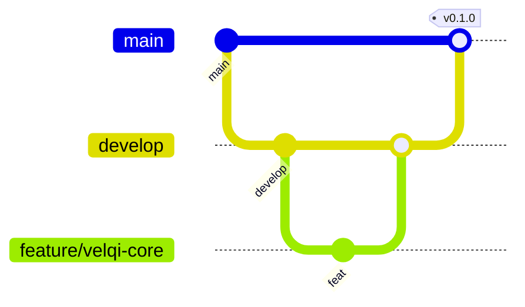

# Como contribuir

## Branches



| Branch | Para quê | Recebe merge de |
| --- | --- | --- |
| `main` | Versões estáveis, sempre com tag | `develop` (release) ou `hotfix/*` |
| `develop` | Integração do trabalho em andamento | `feature/*`, `fix/*`, `docs/*`, `chore/*` |
| `feature/<assunto>` | Funcionalidade nova | — |
| `fix/<assunto>` | Correção | — |
| `docs/<assunto>` | Só documentação | — |
| `chore/<assunto>` | Configuração, CI, dependências | — |
| `hotfix/<assunto>` | Correção urgente em `main` | — |

Regras:

- Ninguém faz push direto em `main` ou `develop`: tudo entra por PR.
- O PR aponta para `develop`. Só release e hotfix apontam para `main`.
- Branches de trabalho são apagadas depois do merge.

## Commits: Conventional Commits

```text
<tipo>(<escopo opcional>): <descrição no imperativo, em pt-BR>
```

| Tipo | Quando usar |
| --- | --- |
| `feat` | Funcionalidade nova |
| `fix` | Correção de bug |
| `docs` | Só documentação |
| `chore` | Configuração, CI, dependências |
| `refactor` | Mudança de código sem mudar comportamento |
| `test` | Testes |
| `style` | Formatação, sem mudança de lógica |
| `perf` | Desempenho |

Exemplos:

- `docs(produto): adiciona requisito RF-H08 da página Sobre`
- `feat(skills): cria velqi-core com guardrails G1–G6`
- `chore(ci): adiciona verificação de links na documentação`

> **Por que esse padrão:** o histórico vira uma lista legível do que mudou. Mais tarde, o changelog e a versão (semver) podem ser gerados automaticamente a partir dos commits.

O **título do PR** segue o mesmo padrão, e o CI verifica isso.

## Pull requests

1. Abra o PR para `develop` e preencha o template.
2. Cite os IDs de requisito (`RF-…`, `RNF-…`) e de ADR afetados.
3. Mudou comportamento? Atualize a documentação no mesmo PR.
4. O CI precisa estar verde e ter uma aprovação de code owner.

## Documentação

- Arquivos em `kebab-case.md`, em pt-BR.
- Comece cada documento pela conclusão (o "o quê"), depois o detalhe.
- Diagramas em Mermaid dentro do Markdown, para versionar junto com o texto.
- Decisões de arquitetura: crie uma ADR a partir de `docs/arquitetura/adr/0000-template.md`.

## Rodar as verificações localmente

```bash
# lint de Markdown
npx markdownlint-cli2 "**/*.md"

# links quebrados (precisa do lychee instalado)
lychee --offline --no-progress "**/*.md"
```
