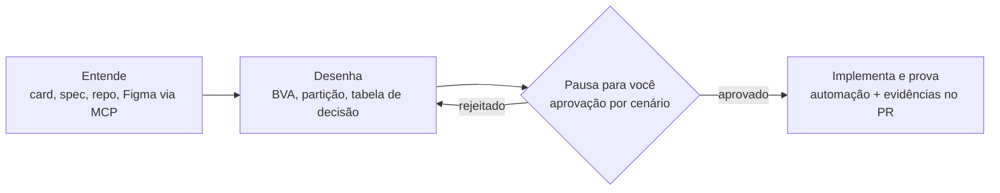
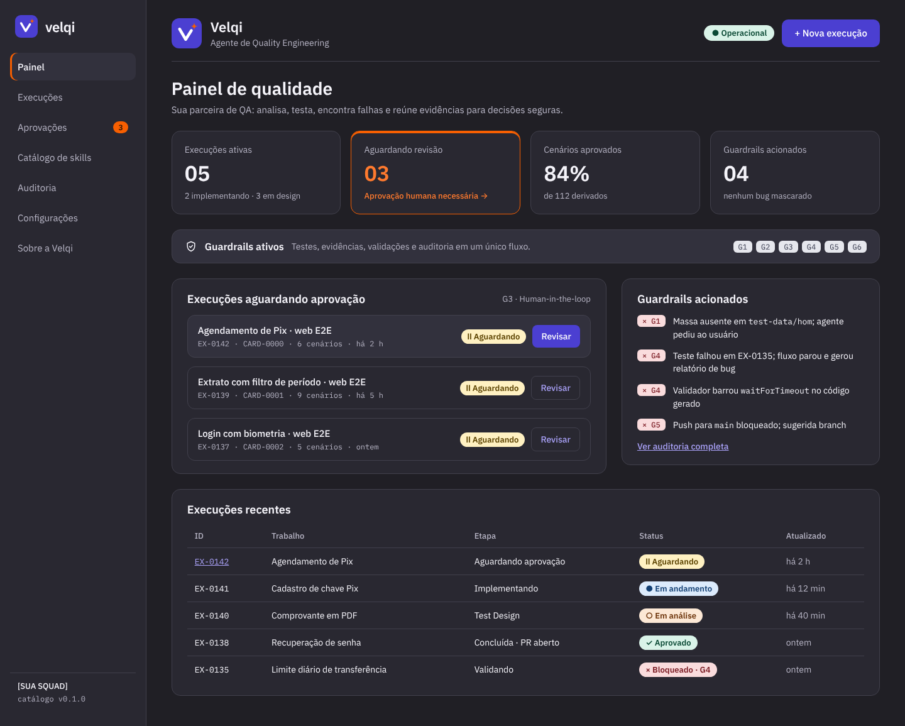
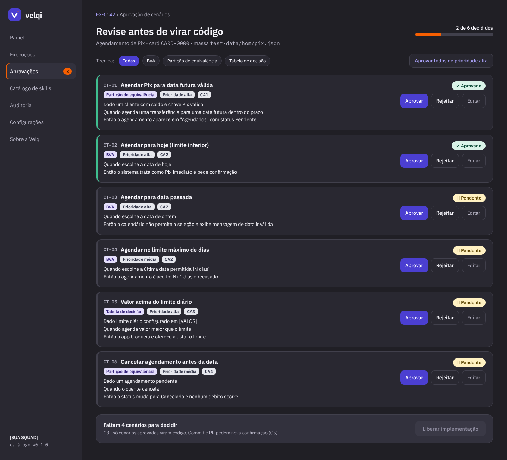
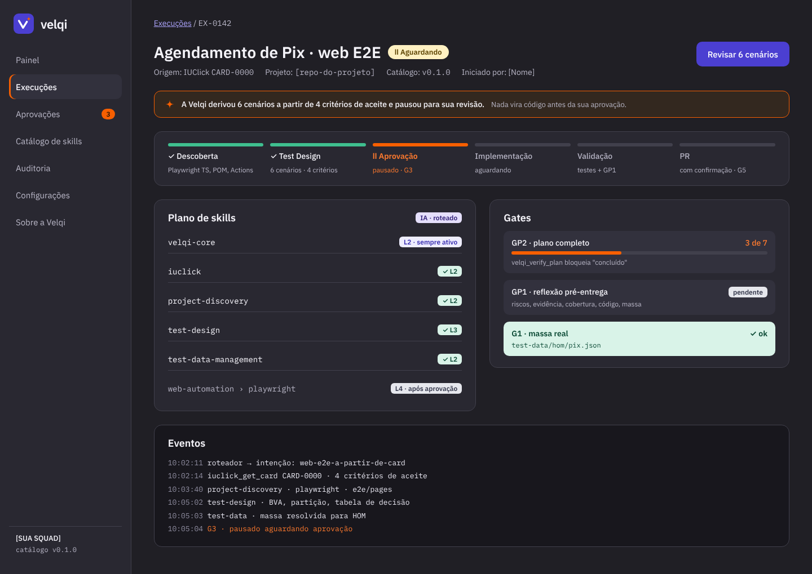
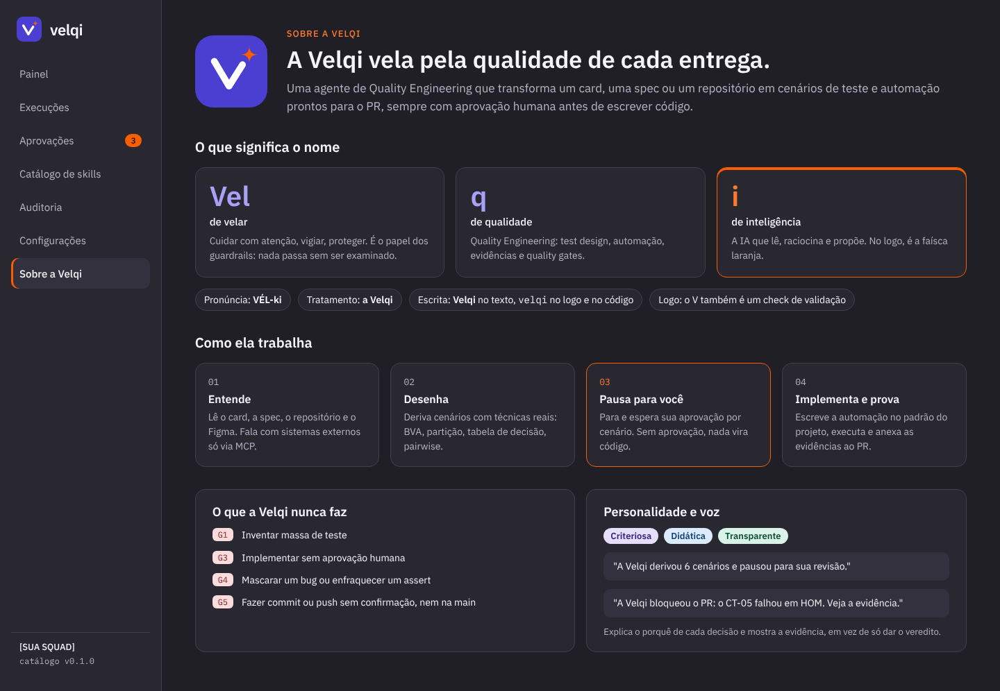
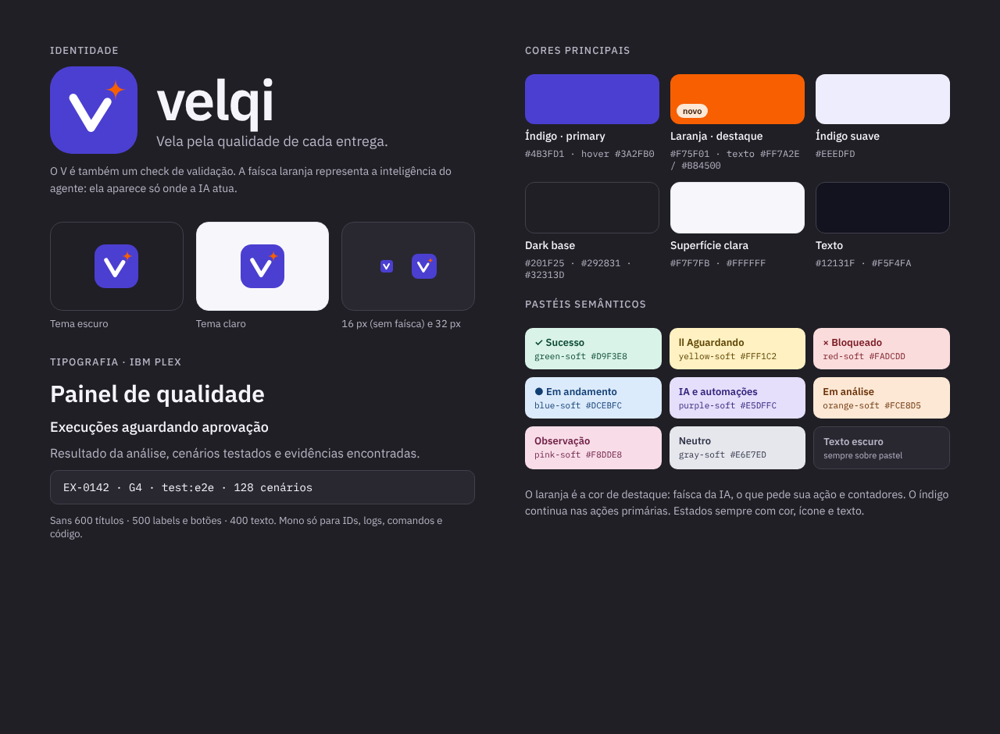
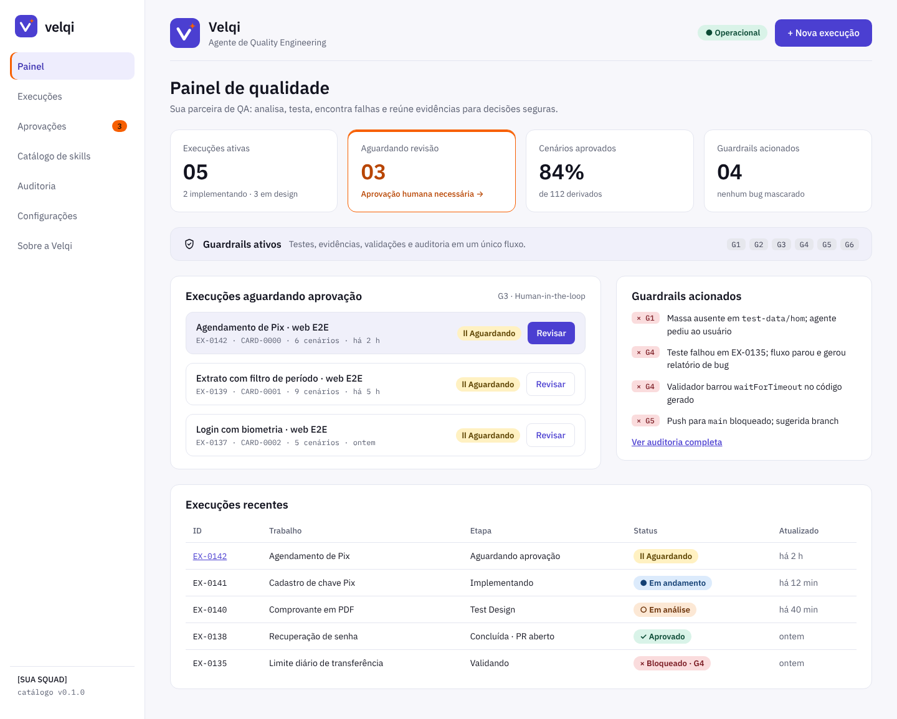

  

<h1 align="center">Velqi</h1>

<strong>A Velqi vela pela qualidade de cada entrega.</strong>

  Agente de Quality Engineering com console em Angular, aprovação humana e auditoria de ponta a ponta.

---

## O que é

A **Velqi** é uma agente de Quality Engineering que transforma um card, uma spec ou um repositório em cenários de teste e automação prontos para o PR, **sempre com aprovação humana antes de escrever código**.

Ela parte do modelo do QA Agent NQD (catálogo de skills + guardrails) e acrescenta um **console web em Angular**. No console, a squad acompanha as execuções, aprova cada cenário e audita o que o agente fez.

> **Analogia:** o catálogo de skills é o livro de receitas que qualquer agente de IA consegue ler. A Velqi é a cozinha inteira: o mesmo livro, um painel na parede mostrando qual prato está saindo e em que etapa, e um botão para o chef humano aprovar antes de ir ao forno.

### O nome

| Parte | Vem de | Significado no produto |
| --- | --- | --- |
| **Vel** | *velar* | Cuidar com atenção, vigiar, proteger: os guardrails |
| **q** | *qualidade* | Quality Engineering: test design, automação, evidências |
| **i** | *inteligência* | A IA que lê, raciocina e propõe; no logo, a faísca laranja |

Pronúncia: **VÉL-ki** · Tratamento: **a Velqi** · Em código: `velqi`.

## Como ela trabalha

O que a Velqi **nunca** faz:

- **G1:** inventar massa de teste.
- **G3:** implementar sem aprovação humana.
- **G4:** mascarar um bug ou enfraquecer um assert.
- **G5:** fazer commit ou push sem confirmação, e nunca na `main`.

## Protótipo

Protótipo navegável do console, ainda sem o front em Angular. As versões em HTML estão em [`docs/design/prototipo/html`](docs/design/prototipo/html).

| Painel de qualidade | Aprovação HITL |
| --- | --- |
|  |  |

| Detalhe da execução | Sobre a Velqi |
| --- | --- |
|  |  |

| Identidade visual | Tema claro |
| --- | --- |
|  |  |

## Documentação

| Área | Conteúdo |
| --- | --- |
| [Produto](docs/produto) | Visão, sistema de referência, escopo, requisitos e critérios de aceite |
| [Arquitetura](docs/arquitetura) | Visão arquitetural e decisões registradas (ADRs) |
| [Design](docs/design) | Identidade visual, tokens e protótipo |
| [Prompts](docs/prompts) | Prompts de criação, implementação e validação |
| [Implementação](docs/implementacao) | Roadmap, organização do repositório e glossário |

Comece pelo [índice da documentação](docs/README.md).

## Status

**Fase atual:** descoberta e especificação. Nenhum código de produção ainda.

- [x] Requisitos funcionais e não funcionais
- [x] Identidade visual e protótipo
- [x] Estrutura de documentação e CI de docs
- [ ] Decisões em aberto (ver [ADRs propostos](docs/arquitetura/adr))
- [ ] Catálogo de skills (`velqi-core`, roteamento)
- [ ] Console Angular
- [ ] API (BFF)

## Contribuindo

Fluxo de branches, padrão de commits e checklist de PR estão em [CONTRIBUTING.md](CONTRIBUTING.md).
