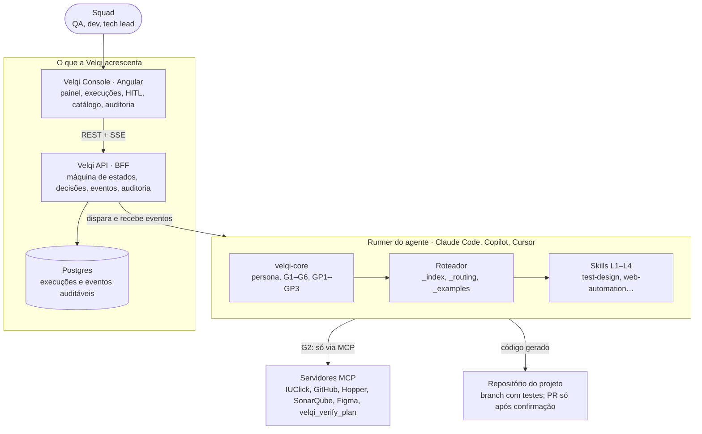
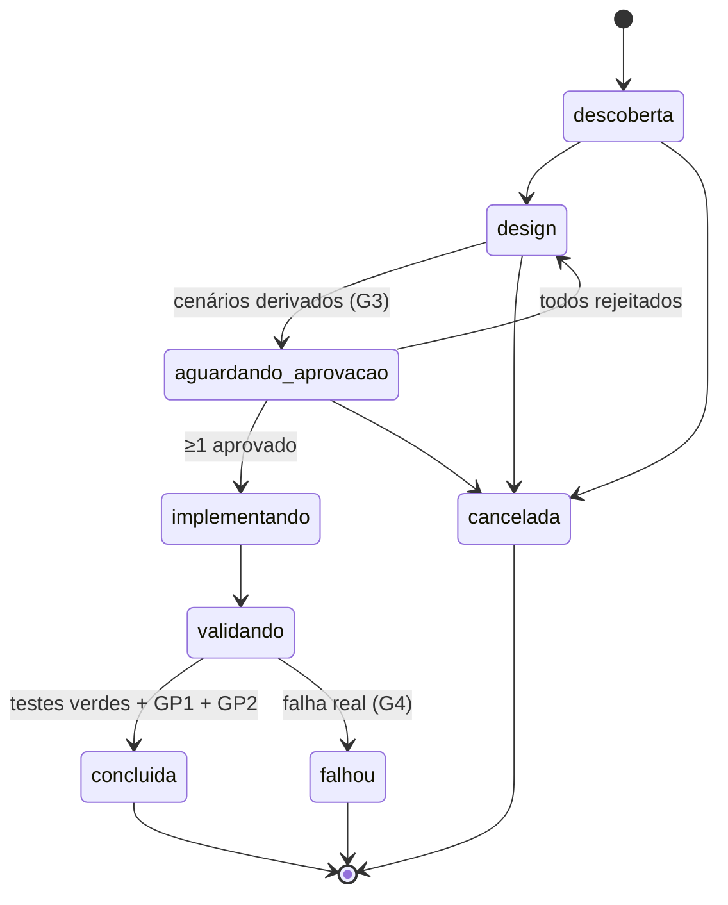

# Visão arquitetural

Regra de ouro das camadas:

- o console fala só com a API;
- a API dispara o agente e recebe os eventos dele;
- o agente fala com sistemas externos só via MCP e escreve código só no repositório do projeto.

> **Analogia:** o console é a torre de controle, a API é o rádio, o runner é o piloto e os MCPs são os instrumentos. O piloto voa, mas pede autorização à torre antes de pousar (HITL), e tudo fica gravado na caixa-preta (auditoria).

## Diagrama



## Stack proposta

| Camada | Tecnologia | Por quê | Status |
| --- | --- | --- | --- |
| Console | Angular (standalone, signals, control flow novo), Angular CDK | Padrão do time; signals simplificam o estado em tempo real | [ADR 0003](adr/0003-console-em-angular.md) aceita |
| Tempo real | SSE | O fluxo é só servidor → cliente; mais simples que WebSocket atrás de proxy | Proposta |
| API (BFF) | Go hexagonal ou NestJS | Go reaproveita o padrão do Rollout Service; NestJS unifica a linguagem | [ADR 0004](adr/0004-linguagem-do-bff.md) proposta |
| Banco | Postgres | Execuções e auditoria são relacionais e precisam de histórico | Proposta |
| Runner | Claude Code / Copilot em modo headless com as skills | Mantém o modelo do NQD: o motor é o agente de código | [ADR 0005](adr/0005-onde-o-agente-roda.md) proposta |
| MCP | Python + FastMCP + httpx | Igual ao sistema de referência; reaproveita os SDKs hopper e iuclick | Proposta |
| CLI e catálogo | Node, pacote npm no Artifactory | Mesma distribuição do `qa-agent` | Proposta |
| Observabilidade | Datadog (logs, APM, RUM) | Já usado nos MFEs do time | Proposta |

## Máquina de estados da execução



Transições fora deste diagrama são rejeitadas pela API, e toda transição gera um evento de auditoria.

## Estrutura planejada do console

```text
velqi-console/src/app/
  core/            auth (OIDC), interceptors, guards por perfil, sse.service
  design-system/   tokens.css, botão, badge de status, card, tabela
  shared/          pipes (mascarar CPF/conta), componentes genéricos
  features/
    painel/
    execucoes/     lista, detalhe (linha do tempo, logs, diff)
    aprovacao/     HITL por cenário
    catalogo/      skills por categoria, detalhe da skill
    auditoria/
    configuracoes/ conexões MCP
    sobre/         significado do nome e resumo da IA
```
